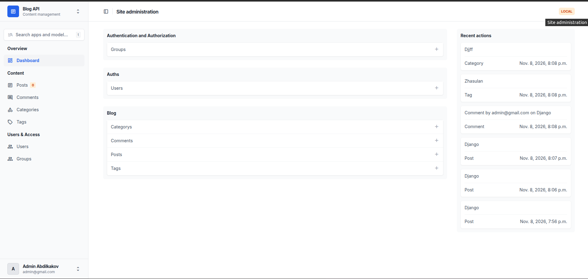
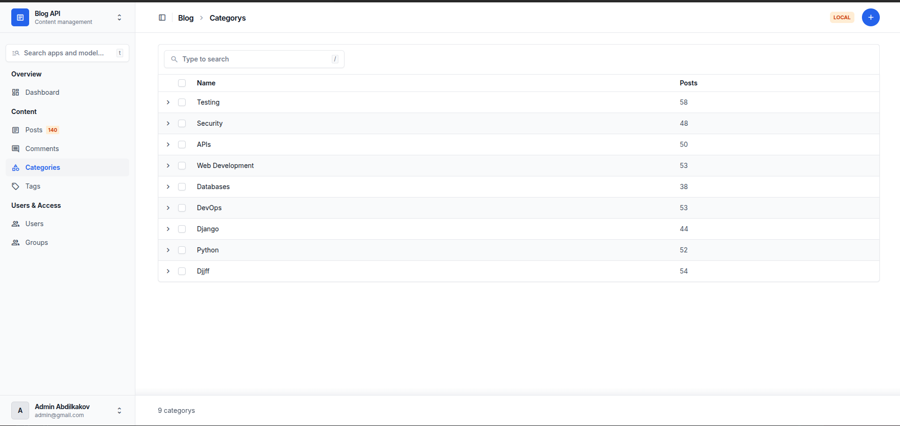
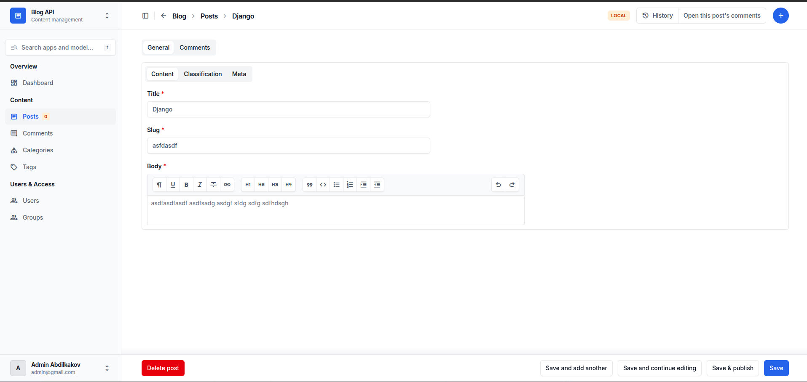
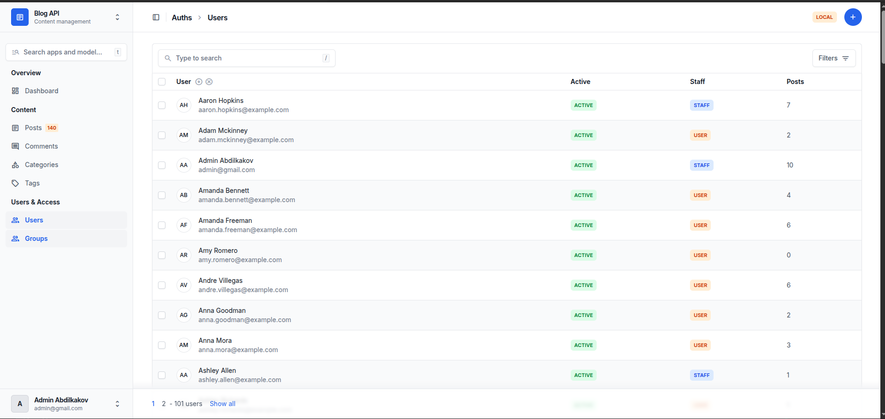

# Blog API

Django REST API for users, categories, tags, posts and comments. The project uses a custom user model with email authentication, JWT and an administration panel styled with Django Unfold.

## ERD


## Setup

```bash
python3 -m venv .venv
source .venv/bin/activate
python -m pip install -r requirements/dev.txt
cp settings/.env.example settings/.env
python manage.py migrate
python manage.py seed
python manage.py createsuperuser
python manage.py runserver
```

Configure `settings/.env` for your environment before running the project. Do not commit this file to Git.

Admin panel: `http://127.0.0.1:8000/admin/`

## API

- `/api/categories/`
- `/api/tags/`
- `/api/posts/`
- `/api/comments/`
- `/api/token/` — obtain JWT tokens
- `/api/token/refresh/` — refresh a JWT token

## Seeding

The `seed` management command generates users, categories, tags, posts and comments with Faker.

```bash
python manage.py seed
python manage.py seed --users 50 --posts 300 --comments 1500
python manage.py seed --clear
python manage.py seed --help
```

| Argument | Default | Description |
| --- | --- | --- |
| `--users` | `20` | Number of users to create |
| `--posts` | `100` | Number of posts to create |
| `--comments` | `500` | Number of comments to create |
| `--clear` | Off | Delete existing comments, posts, tags, categories and non-superusers before seeding |

The command creates about eight predefined categories and twenty predefined tags. Posts are generated with approximately 70% published and 30% drafts; comments belong only to published posts. Seeded users share the password configured in `SEED_PASSWORD` in `apps/blog/management/commands/seed.py`. These are test accounts, not production accounts.

## Admin panel — Django Unfold

The admin panel includes:

- Dashboard with user, post and comment statistics, posts per category, top authors and publication percentages.
- Category and tag management with searchable names, automatic slugs and post counts.
- Comments with search, filters and author/post autocomplete.
- Users with status indicators, post counts, form tabs and activation/deactivation actions.
- Posts with status, category, tags and author filters, a rich-text editor, inline comments and publishing actions.
- Sidebar navigation, model search and post status tabs.

### Screenshots

**Dashboard**



**Post list with filters open**



**Post edit page**



**User list**



## Code checks

```bash
python -m ruff check .
python manage.py check
```
