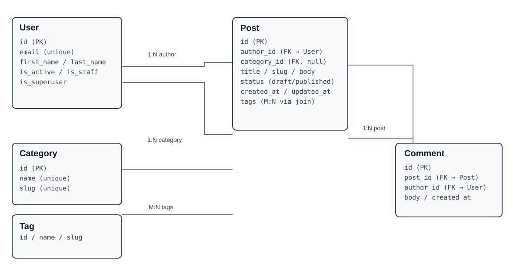

# Blog API — Homework 1

Django REST API with a custom email-login user model, JWT authentication,
posts, comments, categories and tags.

## ERD



## Local setup

Use Python 3.12 or newer.

```bash
python -m venv .venv
source .venv/bin/activate
pip install -r requirements/dev.txt
cp settings/.env.example settings/.env
python manage.py makemigrations auths blog
python manage.py migrate
python manage.py createsuperuser
python manage.py runserver
```

The `.env` file is local and excluded from Git.

## API

- `/api/categories/`
- `/api/tags/`
- `/api/posts/`
- `/api/comments/`
- `/api/token/` — JWT login with email and password
- `/api/token/refresh/` — JWT refresh

The blog endpoints expose ordinary REST CRUD operations. Reading is public;
writing requires a valid JWT bearer token.

## Production

`BLOG_ENV_ID=prod` selects the PostgreSQL configuration.
Install `requirements/prod.txt` on the production server.
